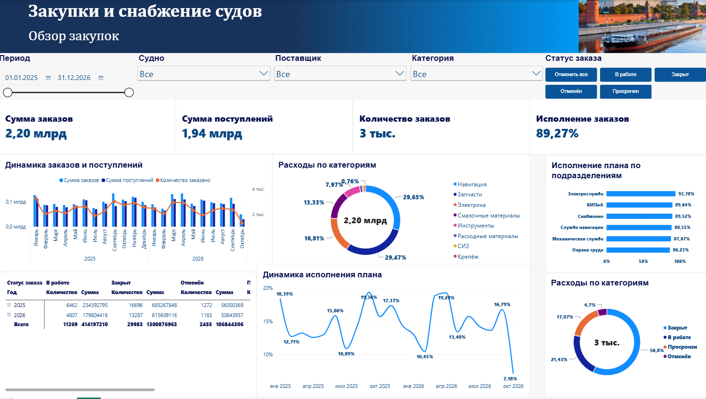

# ship-procurement-powerbi
# Закупки и снабжение судов — Power BI Dashboard

## О проекте

Интерактивный аналитический дашборд для мониторинга закупок и снабжения судов. Отчёт позволяет анализировать суммы заказов и поступлений, отслеживать статусы исполнения заказов, изучать структуру расходов и контролировать выполнение плана подразделениями.

## Цель проекта

Предоставить удобный инструмент для анализа закупочной деятельности, контроля исполнения заказов и оценки эффективности работы подразделений.

## Ключевые показатели (KPI)

- **Сумма заказов** — общая сумма оформленных заказов.
- **Сумма поступлений** — сумма поступивших товаров и услуг.
- **Количество заказов** — общее количество заказов.
- **Исполнение заказов** — доля исполнения заказов в денежном выражении.

## Основные визуализации

- **Динамика заказов и поступлений** — сравнение сумм заказов, поступлений и количества заказов по месяцам.
- **Расходы по категориям** — анализ структуры закупочных расходов по категориям.
- **Исполнение плана по подразделениям** — сравнение показателей исполнения между подразделениями.
- **Динамика исполнения плана** — отслеживание изменений процента исполнения во времени.
- **Распределение заказов по статусам** — анализ количества и суммы заказов в разных статусах.
- **Расходы по статусам заказов** — оценка распределения общего количества заказов между статусами.

## Фильтры и интерактивность

Пользователь может анализировать данные с помощью следующих фильтров:

- Период — выбор начальной и конечной даты.
- Судно — анализ закупок для выбранного судна.
- Поставщик — анализ заказов по поставщикам.
- Категория — отбор закупок по категориям.
- Статус заказа — фильтрация по статусам: «В работе», «Закрыт», «Отменён», «Просрочен».

## Инструменты

- Microsoft Power BI Desktop
- Power Query
- DAX
- Визуализация и анализ данных

## Практическая ценность

Дашборд помогает:
- Контролировать объём заказов и поступлений.
- Отслеживать исполнение заказов и выявлять проблемные статусы.
- Анализировать структуру расходов по категориям.
- Сравнивать исполнение плана между подразделениями.
- Отслеживать динамику показателей во времени.

## Скриншот дашборда

## Данные

Проект предназначен для демонстрации навыков анализа данных и разработки интерактивных отчётов в Power BI.

